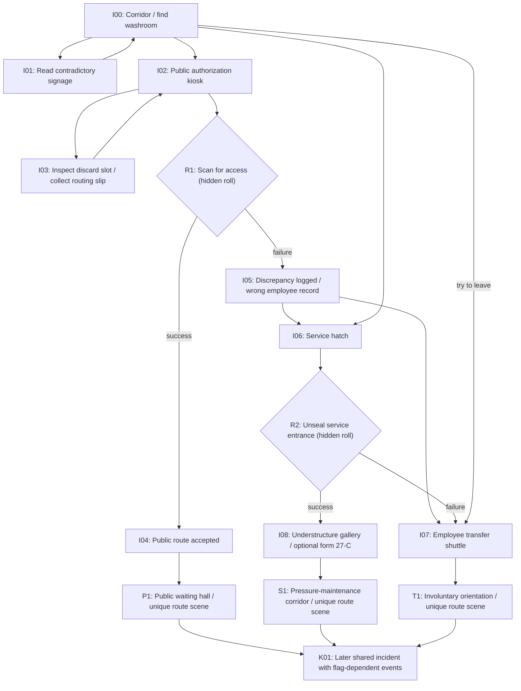

# Branching + Dice Paper Test v0.1 — Washroom Access

**Date:** 2026-11-07  
**Status:** Exploratory *non-canon* gameplay paper test. **Not a task for the M2 reception implementation.**  
**Companion:** [56 Parallel Creative Track Plan](56_PARALLEL_CREATIVE_TRACK_PLAN_V01.md)  
**Purpose:** Evaluate whether House of Danger-style acquired-item odds and Detroit-like branch outcomes can coexist in a single, compact non-NPC CYOA incident/chapter segment.

## Test question and hypotheses

1. **Branch breadth:** Can three substantially different short chapter outcomes feel meaningful without exponentially multiplying all later scenes?
2. **Dice:** Are hidden checks fun when better preparation helps but never guarantees success?
3. **Items:** Do acquired objects affect more than inventory display?
4. **Non-NPC grammar:** Can an environmental incident carry an entire playable sequence without making every encounter a conversation?
5. **Bathroom premise:** Does the simple objective remain comically legible even while institutions keep inventing responsibilities?

This prototype follows the reception setup only **conceptually**. Do not import or alter M2 reception runtime/state: define its own initial item flags.

## Scene premise

The protagonist has just left reception with confusing directions to an allegedly nearby washroom. A corridor contains contradictory signs, a public-use authorization kiosk, a service ramp, and an exit. Every route eventually takes them further from a working bathroom. **Current Objective: FIND A WASHROOM.**

Use existing shell *semantics* in notes only: main scene shows the location, right focus is a higher-detail sign, device or document, and choices remain the driving interaction. The prototype requires **no production art or runtime UI**.

## State vocabulary (candidate; scoped to this test only)

- `has_bathroom_pass`: boolean, initial condition selectable (models a possible item from M2; not an integration claim).
- `noticed_sign_conflict`: boolean, observation flag.
- `has_routing_slip`: boolean, acquired in test.
- `has_form_27c`: boolean, optional evidence found on service route.
- `incorrect_employee_record`: boolean, consequence of failed administrative processing or attempted escape.
- `route`: `public` | `service` | `transfer`.
- `attempted_leave`: boolean.
- `used_r1`, `used_r2`: booleans to prevent farming and clarify retries.
- `incident_id`: current passage (do **not** equate with a game-engine schema).

No need for visible attributes, RPG abilities, currencies, permanent injuries or NPC trust meters in this test.

## Candidate chart

**Important:** this graph is a **design-test map**, not literal required content or a promise of three chapters. Each route earns a short *distinct follow-on incident* before the shared later pivot. States remain different after gathering.

## Micro-script nodes, choices and consequence

### I00 — A Corridor for Public Relief

Main scene: a concrete corridor with two incompatible directional signs, an unattended authorization kiosk, and a service ramp. The framed focus could show a sign whose arrow has been corrected repeatedly.

Narration sketch:

> The receptionist had given me a bathroom pass and directions. There appeared to be a new requirement between me and the bathroom: permission to interpret the directions.

**Choices:**
- **READ THE SIGNS CAREFULLY** → I01 (observation, no roll).
- **USE THE PUBLIC AUTHORIZATION KIOSK** → I02.
- **TRY THE SERVICE HATCH** → I06.
- **GO BACK OUTSIDE** → I07; set `attempted_leave=true`, `incorrect_employee_record=true` (institution interprets exit as a transfer).

### I01 — Signage

The signage contradictory wording itself is a small world joke, not a secret. The protagonist notices the kiosk calls “visitors” those whose location has not been established.

Set `noticed_sign_conflict=true` (later grants a modest preparation bonus). Return to I00; do not allow repeated observation to stack bonuses.

### I02 — The Public Authorization Kiosk

No speaking NPC. Upper-right focus: molded keypad and a faded notice; center text register: institutional machine text, framed as a document, not dialogue.

Choices:
- **SUBMIT MY DETAILS** → R1.
- **EXAMINE THE DISCARDED PAPERS** → I03 (once; optional).
- **USE THE SERVICE HATCH INSTEAD** → I06.

### I03 — The Disposal Slot

Retrieve **BLUE ROUTING SLIP** from a misfiled bin. Add inventory item `has_routing_slip=true`. It is not a guaranteed key. It will modify R2 (and can be mentioned later). Return to I02. Repeated inspection yields no duplicate item.

### R1 — Access Verification Check

A hidden roll tests whether the kiosk accepts the protagonist's claimed authority. Optional `has_bathroom_pass` and `noticed_sign_conflict` may improve odds.

- **Success → I04:** set `route=public`. The kiosk approves access **to a waiting area for the department that approves access to washrooms**; not to a bathroom.
- **Failure → I05:** the kiosk flags a discrepancy and creates an erroneous employee record; set `incorrect_employee_record=true`. The player can follow the new transfer instruction or try the service route. A failed roll does not block the chapter.

### I04 — Public Route

The protagonist receives a queue ticket for a public “facilities use assessment.” A public waiting hall P1 is a unique short follow-on scene. The callback at K01 can refer to the queue number or a completed assessment.

### I05 — Discrepancy Response

The kiosk prints a new job classification. It has a field labelled `EXPLANATION OF ERROR (OPTIONAL)` and a mandatory signature field. The protagonist can attempt the service hatch or accept the transfer shuttle. No automatic retry of R1 in the same run.

### I06 / R2 — Service Hatch Check

A heavy hatch bears a notice that no one with authorization should open it. The protagonist can attempt to open it as an uncertain action.

- **Success → I08:** service route opens.
- **Failure → I07:** an alarm quietly requests an employee-transfer vehicle. Set `incorrect_employee_record=true`. Failure changes the storyline.
- Option **GO BACK** to I00 before attempting; no check just for reconsidering. R2 may not be repeated without a future new circumstance.

### I08 — Understructure Gallery

The gallery contains pneumatic tubes used for something that looks alarmingly like a water return circuit. The player can discover **FORM 27-C: FACILITY REALLOCATION** (set `has_form_27c=true`) or proceed. Do not confirm any final Exchange truth here. Move to unique short S1 service scene.

### I07 — Employee Transfer Shuttle

If reached by an attempted departure, the shuttle interprets leaving as voluntary transfer. Otherwise it collects newly flagged employees. No NPC necessary: recorded announcement and a printed ticket suffice.

Set `route=transfer`, then go to unique short T1 orientation scene. The text should acknowledge whether `attempted_leave` or a failed check brought the protagonist here.

### P1 / S1 / T1 — Distinct consequences

- **P1 (public):** a cramped hall waiting for an inspection of the applicant's bathroom entitlement. Possible chance to discover a form relating to another office.
- **S1 (service):** maintenance spaces and curious records; optional evidence from I08 matters.
- **T1 (transfer):** mistaken worker orientation in which the protagonist learns a new incorrect job title.

All are **different experiences**, not the same text with a changed label. After their meaningful beat, converge at a later required story pivot K01.

### K01 — Delayed callback

A shared downstream scene checks:
- public route: queue identity is recognized;
- service route: the protagonist understands the hidden infrastructure;
- transfer route: officials expect an employee;
- `has_form_27c`: an evidence-specific option appears;
- `has_routing_slip`: can prove the protagonist was routed incorrectly, or further confuse the registry;
- `incorrect_employee_record`: changes an institutional response;
- `attempted_leave`: possible especially absurd callback.

The common dramatic event remains coherent for all paths; not every path needs every revelation.

## Dice balance comparison: TWO candidates, same graph

### Model A — House of Danger-like 1d6

One hidden d6 roll. On a natural 1, **failure regardless of bonuses** (this mirrors a feature of the referenced tabletop rules but is only a candidate for our game).

- R1 kiosk: target **4 or more**; +1 with bathroom pass, +1 if signage studied.
- R2 hatch: target **5 or more**; +1 with routing slip, +1 if signage studied.
- Total situational bonuses cap at +2 in this test.

| Check | No preparation | One qualifying bonus | Two qualifying bonuses |
| --- | ---: | ---: | ---: |
| R1, target 4 | 3/6 = 50% | 4/6 = 66.7% | 5/6 = 83.3% |
| R2, target 5 | 2/6 = 33.3% | 3/6 = 50% | 4/6 = 66.7% |

Formula for reproduction: if raw die == 1 → fail; otherwise succeed if raw die + modifiers >= target.

### Model B — d100 / exact percent

One hidden uniform integer 1–100. Success if roll <= computed threshold.

- R1 kiosk: base **45%**, +20 percentage points for bathroom pass, +15 for sign knowledge; ceiling 95%.
- R2 hatch: base **30%**, +20 for routing slip, +10 for sign knowledge; ceiling 95%.

| Check | No preparation | Item only | Knowledge only | Both |
| --- | ---: | ---: | ---: | ---: |
| R1 kiosk | 45% | 65% | 60% | 80% |
| R2 hatch | 30% | 50% | 40% | 60% |

**These are illustrative tuning values, not recommendations for production.** Both models provide risk and an item advantage; their perceived fairness, readability and replay effect must be tested.

### Presentation options to compare

- **Hidden:** Choice is available; failure consequences hinted by narration, no number.
- **Qualitative:** “Risky”, “Fair”, “Favorable” with clear band definitions in internal test data.
- **Percentage:** “45% chance” shown before selecting; item bonus visibly reflected.
- **Die feedback:** Result revealed after choice (“The attempt fails”), with or without an actual die graphic.

Don't settle presentation without checking whether it changes player choices in an unwanted way.

## Playtest cases and acceptance criteria

| Case | Setup / path | Required observation |
| --- | --- | --- |
| A | No pass, no sign observation, R1 success | Public route works without an item; not gated behind inventory |
| B | Pass + sign, R1 natural 1 | Still fails in d6 model; useful item isn't invincible |
| C | No preparation, R1 failure → R2 success | Complication redirects into a different playable route |
| D | Inspect papers → acquire routing slip → R2 | Newly acquired item improves odds; identical check without item differs |
| E | R2 failure | Transfer route is playable; not softlocked |
| F | From I00 choose leave | “Leave” is a meaningful ironic outcome, not just an invalid choice |
| G | Reach K01 via all three routes | Different prior choices have recognizable delayed callbacks |
| H | Re-enter I01/I03 | No duplicate items, infinitely stacking bonuses or infinite retry exploits |
| I | Try a route with all optional items ignored | Still reaches intentional chapter end; no impossible hard gate |
| J | Replay using seed / predefined roll sequence | Same choices and same roll sequence reproduce identical outcomes |

### What to measure in actual test

1. **Comprehension:** Can someone explain why their outcome occurred, even when dice stay hidden?
2. **Choice identity:** Do the routes meaningfully change events, or just wording?
3. **Item value:** Was discovering the routing slip worthwhile without being mandatory?
4. **Fairness:** Can failure feel like story rather than punishment?
5. **Replayability:** Would a player want to try a different route?
6. **Pacing:** How many clicks and words before a consequential outcome?
7. **Branch debt:** Which route-specific content must be accounted for at K01 and after it?

## Deliberate exclusions

- No actual scenes/assets added to the M2 reception branch.
- No final NPC names or fixed story chronology.
- No reveal that the Exchange mechanism is true.
- No complete game plot, city map or final chapter titles.
- No request to create game-ready art from this text.
- No general RPG attribute system.
- No change to locked shell geometry.

## Next local/Claude possibility — ONLY if owner chooses to test mechanically

Make a **standalone text-only offline branching laboratory** in a new independent worktree/branch, not part of `tools/layout-lab`, with:
- test-route runner;
- seedable hidden d6 and d100 check models;
- visible state log for design QA;
- a branch graph or simple report;
- no production UI imports, no sprites, no visual shell changes;
- branch path/state validation;
- print/export summary of each run.

The assistant/PMO can review its test evidence, then propose adjustments. A prototype does **not** authorize merging into main or hooking into M2.
